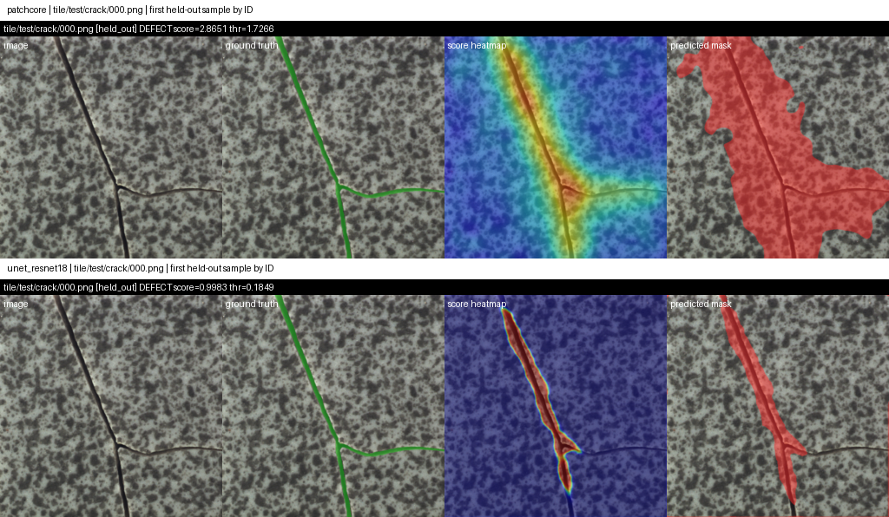
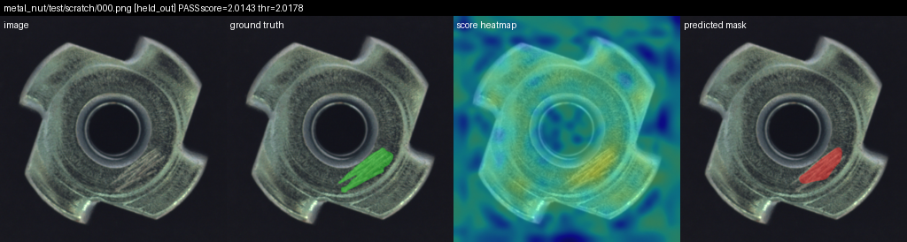
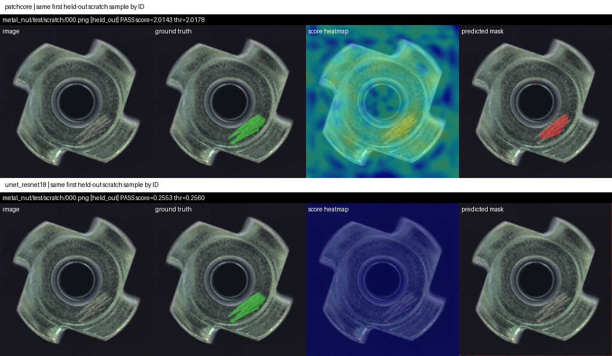

# Kết quả tích hợp và đánh giá chung ngày 21/11/2026

Cập nhật ngày 22/11/2026: đã tải và tái hiện thêm U-Net metal_nut v1, hoàn tất ba
bước bàn giao còn lại của đợt ngày 20–21. Phần kiểm tra chéo Hùng → PatchCore do
Triệu tự trao đổi với Hùng, chưa được đánh dấu nghiệm thu trong tài liệu này.

## Đã tích hợp và kiểm tra

PR #19 đã merge đúng vào main (`9d7c6e6`), gồm cả H02/H04. H03 đã vào main qua
PR #17. Branch local `feat/patchcore-shared-evaluation` kết hợp các phần đó với
hai commit PatchCore; code tích hợp ở `6c5adcc`. Chưa push, tạo PR hay publish
artifact mới. Main local không được di chuyển trong lượt này.

- Loader chung có PatchCore và U-Net; cùng một CLI predict hỗ trợ raw hoặc thêm
  `--calibrated` để dùng ngưỡng, xuất PASS/DEFECT và mask.
- PatchCore dùng lại helper run/provenance và overlay của H03. Git provenance
  không im lặng trả commit null khi Git từ chối quyền sở hữu trên Windows.
- Thêm guard calibration: manifest phải đúng hash đã ghi lúc train, tránh vô tình
  chọn ngưỡng trên một cách chia train/val khác. Chỉ normal val được predict.
- 64 tests đạt, gồm cả regression tests H02/H03 và kiểm tra tích hợp mới. Lint đạt.
- Artifact U-Net tile/metal_nut tải từ Releases đã khớp checksum, load/predict trên CPU
  được khi chặn kết nối mạng. Không train lại U-Net.

## Protocol và cách khóa thí nghiệm

Tất cả bảng dưới là **custom_comparison**, seed 42. Tile giữ riêng crack;
metal_nut giữ riêng scratch. Không trộn với benchmark official AD. PatchCore dùng
ResNet-18, layer2/layer3, ảnh 256×256, coreset 1%, 9 neighbors. U-Net dùng encoder
ResNet-18 và checkpoint Hùng công bố. PatchCore chỉ fit good; U-Net học good và
lỗi đã biết cùng mask, nên hai hướng nhận lượng giám sát khác nhau.

Checkpoint, metadata chứa ngưỡng và manifest được khóa trước khi chạy test tại
`outputs/day21/frozen-evaluation/lock.json`. Hash của ba artifact đợt đầu không đổi
sau test; U-Net metal_nut bổ sung có lock ngày 22 riêng ở mục bên dưới.
PatchCore đây là lượt full custom test đầu tiên; U-Net tile là tái hiện
kết quả Hùng đã công bố và đã xem trước đó, không phải một test chưa từng được xem.
Không đổi config/model/ngưỡng dựa vào các kết quả này.

| Model/category | Good fit | Lỗi fit | Good để calibrate | Ngưỡng ảnh | Ngưỡng pixel | Test |
| --- | ---: | ---: | ---: | ---: | ---: | ---: |
| PatchCore tile | 184 | 0 | 46 | 1.726650 | 1.630425 | 67 |
| PatchCore metal_nut | 176 | 0 | 44 | 2.017776 | 1.936933 | 61 |
| U-Net tile | 184 | 38 | 46 | 0.184943 | 0.031672 | 67 |
| U-Net metal_nut v1 | 176 | 41 | 44 | 0.255985 | 0.061297 | 61 |

Ngưỡng ảnh/pixel của PatchCore dùng quantile 0.95/0.995 từ config artifact qua H03.
U-Net giữ nguyên ngưỡng trong artifact Release; phương pháp và normal val khớp
config hiện tại. Score native của các model khác thang, không đọc như confidence.

## Kết quả đã đo local

| Model/category | Image AUROC | Image F1 | Good báo nhầm | Recall known | Recall held-out | Pixel AUROC | Pixel AP | Dice ảnh lỗi |
| --- | ---: | ---: | --- | --- | --- | ---: | ---: | ---: |
| PatchCore tile | 0.9973 | 0.9565 | 2/33 | 16/17 | crack 17/17 | 0.9395 | 0.3026 | 0.4052 |
| PatchCore metal_nut | 0.9895 | 0.9487 | 2/22 | 16/16 | scratch 21/23 | 0.9819 | 0.7943 | 0.6317 |
| U-Net tile | 1.0000 | 1.0000 | 0/33 | 17/17 | crack 17/17 | 0.9704 | 0.9194 | 0.6282 |
| U-Net metal_nut v1 | 0.8800 | 0.8000 | 12/22 | 16/16 | scratch 18/23 | 0.9307 | 0.8590 | 0.5778 |

Tile PatchCore và U-Net dùng đúng cùng 67 sample IDs; metal_nut cùng 61 sample IDs.
Dice/IoU chính là trung bình
trên ảnh lỗi; không trộn ảnh good để làm đẹp điểm. Dice ảnh good U-Net bằng 0 vì
mỗi ảnh có vài pixel vượt ngưỡng pixel, dù quyết định cấp ảnh vẫn PASS. Hai ngưỡng
phục vụ hai mục tiêu khác nhau, không nên ép chúng thành một quyết định duy nhất.

| Model/category | Dice known | Dice held-out | Mean latency ms/ảnh trên GTX 1650 |
| --- | ---: | ---: | ---: |
| PatchCore tile | 0.7006 | 0.1098 | 19.20 |
| PatchCore metal_nut | 0.6825 | 0.5964 | 17.47 |
| U-Net tile | 0.8840 | 0.3723 | 15.40 |
| U-Net metal_nut v1 | 0.7496 | 0.4583 | 13.78 |

Latency gồm preprocessing + inference + postprocessing về ảnh gốc, batch 1,
3 warm-up, CUDA synchronization. Đây là một lượt đo cùng máy; chưa có đo model-only
riêng hoặc peak RAM của cả tiến trình. Không so trực tiếp 15.40 ms local với
9.8 ms Hùng ghi trên RTX 4050. Fit time/VRAM fit nằm trong bàn giao PatchCore trước.

## Tái hiện U-Net tile

Nguồn là Release `unet-tile-holdout-crack-v1` của repo:

- Artifact ZIP SHA-256: `ad27d7a39762028e9dc898c6826440d650739383a8c7d74401c0ed6a0509b004`.
- Output ZIP SHA-256: `40620773781de6862d5add5b3ca97587fdd01f187648227539f4c86784bac697`.
- Local và reference cùng 67 test IDs, cả 67 quyết định cấp ảnh giống nhau.
- Image metrics khớp; sai lệch pixel metric lớn nhất khoảng 0.00000847.
- Sai lệch image score lớn nhất khoảng 0.0001501. Đây là tái hiện gần đúng số thực
  giữa hai môi trường/GPU, không khẳng định bit-exact. Không thay ngưỡng để ép khớp.
- Metadata Release giữ nguyên commit/dirty status cũ của Hùng. Code lúc đánh giá
  local được ghi riêng trong metrics và evaluation lock, không sửa provenance cũ.

## Tái hiện U-Net metal_nut — bổ sung ngày 22/11

Nguồn: Release `unet-metal-nut-holdout-scratch-v1`, run
`20261121-162901-seed42-holdout-scratch`.

- Artifact ZIP SHA-256: `aeb4342a326b58abca5faeb5d5e6dc75008bad2429d25733fb35d29c9684f6f2`.
- Output ZIP SHA-256: `b52cb4a0a7511328a24ed24fca47fabfa8b3be2b35ecc6334ce34106a1beb82f`.
- Metadata đúng model/category/fold, training và validation manifest cùng hash đã
  chốt. Đã kiểm tra load/predict offline trên CPU với ảnh good và bent của val.
- Giữ nguyên checkpoint/ngưỡng v1. Lock bổ sung ở
  `outputs/day22/frozen-metal-nut-v1/lock.json`, hash không đổi sau test.
- Local và reference cùng 61 test IDs, tất cả quyết định cấp ảnh giống nhau;
  image metrics khớp. Sai lệch pixel metric lớn nhất khoảng 0.00001823, image score
  lớn nhất khoảng 0.00086421. Không phải bit-exact giữa hai môi trường/GPU.
- Không train lại, không đổi quy tắc max map, không recalibrate. Bản v1 giữ nguyên
  FPR 12/22 và scratch recall 18/23 như Hùng công bố.
- Trên ảnh good validation đã kiểm tra, điểm max nằm ở góc `(0,699)`, phù hợp vấn
  đề viền đã ghi trong Release. Không suy rộng từ một ảnh thành mọi ảnh good.

## Điều có thể nói trong báo cáo

PatchCore phát hiện lỗi mà không cần ảnh lỗi hoặc mask ở giai đoạn fit. Trong fold
tile này, cả hai model đều phát hiện đủ crack giữ riêng; U-Net tốt hơn ở cấp ảnh
và mask. Vì vậy chưa có bằng chứng anomaly vượt supervised trong fold này.
Khả năng nhận biết ảnh có lỗi không đồng nghĩa khoanh đúng toàn bộ vùng lỗi:
PatchCore bắt đủ crack nhưng Dice crack chỉ 0.1098. Đây là giới hạn quan trọng.

Ở metal_nut, PatchCore phát hiện 21/23 scratch, đồng thời vẫn có hai good báo nhầm.
U-Net metal_nut v1 phát hiện 18/23 scratch và có 12 good báo nhầm; v1 đang bị ảnh
hưởng bởi score viền. PatchCore tốt hơn về các chỉ số cấp ảnh trong phép so sánh
này, còn U-Net có Pixel AP cao hơn. Không dùng một baseline có hạn chế đã biết để
kết luận anomaly luôn tốt hơn supervised. Chỉ có một fold/category, không khái quát
thành mọi lỗi mới. Bản sửa score viền cần PR/Release riêng và giữ lại bảng v1 này.

## Ví dụ và failure cases

Hình tile dùng ảnh crack đầu tiên theo sample ID, không chọn theo điểm tốt nhất.
Cả hai dòng là cùng ảnh; đọc song song quyết định ảnh và mức khớp mask.

Hình dưới là ảnh scratch đầu tiên bị PatchCore bỏ sót sau khi khóa ngưỡng.

So sánh cả hai model trên cùng ảnh scratch đầu tiên theo sample ID:

Các ảnh sai cấp ảnh của PatchCore:

- Tile báo nhầm: `tile/test/good/017.png`, `025.png`; bỏ sót `tile/test/gray_stroke/000.png`.
- Metal nut báo nhầm: `metal_nut/test/good/013.png`, `016.png`; bỏ sót
  `metal_nut/test/scratch/000.png`, `022.png`.

U-Net metal_nut v1 bỏ sót scratch `000.png`, `001.png`, `019.png`, `020.png`,
`022.png`. Danh sách đầy đủ 12 good báo nhầm nằm trong JSON summary cùng thư mục.

Giữ nguyên các lỗi này trong bảng kết quả đầu. Bất kỳ cấu hình thử sau khi đã xem
test cần ghi là thăm dò; không thay bảng đầu bằng số tốt hơn mà bỏ lịch sử.

## File bằng chứng và bước tiếp theo

- Bốn file `*-custom-metrics.json` cùng thư mục là metric đầy đủ đã version.
- `shared-evaluation-summary.json` có bảng, sample IDs đoán sai và sai lệch tái hiện.
- Model, CSV từng ảnh, NPZ map, PNG mask và overlay đầy đủ ở `artifacts/`/`outputs/`
  theo run ID, không đưa dataset hoặc generated runs vào Git.
- Gói calibrated mới và checksum ở `outputs/day21/shared-handoff/`; các ZIP raw cũ
  ở `outputs/day21/handoff/` giữ nguyên. Chưa upload các gói mới lên Releases.
- Bộ bàn giao đầy đủ hơn ngày 22 ở `outputs/day22/handoff/`: source, hai PatchCore
  calibrated, output có CSV/metric/ảnh và checksum. Output ZIP không chứa NPZ maps;
  có thể tạo lại bằng evaluator. Hai Release U-Net được giữ làm tham chiếu.

Triệu đã chạy lại cả hai U-Net. Việc Hùng load hai PatchCore và kiểm tra chéo do
Triệu tự trao đổi với Hùng, ngoài phạm vi ba bước vừa giao. H04 score viền tiếp tục
xử lý ở PR riêng theo thống nhất, giữ số baseline. H05 nối app với loader và
calibrated_predict, so ảnh app với CLI. Kế hoạch push/PR ở
[bản bàn giao ngày 20–21](../review-plan-day20-21.md).

T03 đã có fit/load/calibrate/evaluate tile; còn nghiệm thu chéo và bàn giao công khai.
T05 chỉ xong PatchCore metal_nut, còn EfficientAD. T06 mới có fold crack/scratch,
chưa đủ mọi fold; T07 chưa triển khai. Không tự đóng issue trong lượt này.
