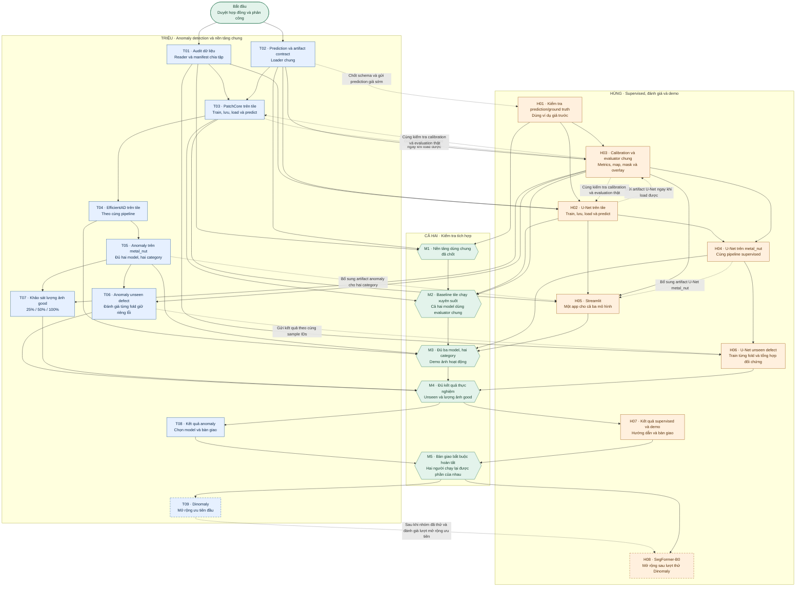

# Workflow của Triệu và Hùng

Sơ đồ dùng đúng mã đầu việc trong [phân công Triệu](assignments/trieu.md) và
[phân công Hùng](assignments/hung.md). Cách đọc và tiêu chí bàn giao dựa trên
[hợp đồng kỹ thuật](development-contract.md). Đây là kế hoạch triển khai.

## 1. Cách đọc sơ đồ

- Ô xanh dương là việc Triệu làm. Ô cam là việc Hùng làm. Ô xanh lá là mốc cả hai
  cùng kiểm tra. Ô nét đứt là việc mở rộng khi còn thời gian.
- Mũi tên liền giữa hai công việc nghĩa là công việc phía trước cần hoàn thành
  trước khi bắt đầu công việc phía sau.
- Mũi tên nét đứt là bàn giao một phần trong lúc đang làm. Nhãn trên mũi tên ghi
  rõ cần gửi gì. Người nhận có thể bắt đầu với phần đó và phản hồi sớm.
- Mũi tên vào mốc M nghĩa là tất cả việc đi vào mốc phải hoàn thành để qua mốc.
  Công việc ở mốc sau vẫn có thể bắt đầu sớm nếu đã đủ đầu vào trong bảng phụ thuộc.
- Các việc có chung đầu vào có thể phát triển song song giữa hai người. Nếu nhiều
  việc cùng thuộc một người, người đó chọn một việc chính và bàn giao từng phần.

## 2. Sơ đồ công việc và các lần bàn giao

Sơ đồ có các đường nét đứt hai chiều ở baseline vì Triệu/Hùng cần trao đổi
artifact và evaluator trong lúc phát triển. Các đường đó mô tả tích hợp dần.
M2 chỉ hoàn tất khi cả ba đầu việc T03, H02 và H03 đã kiểm tra cùng nhau.

## 3. Tra nhanh điều kiện bắt đầu và hoàn thành

Mở từng mã để xem việc cần làm, branch và title commit/PR đã chốt.

| Việc | Người làm | Cần gì để bắt đầu? | Cần thêm gì trước khi đánh dấu hoàn thành? |
| --- | --- | --- | --- |
| [T01](assignments/trieu.md#t01---kiểm-tra-dữ-liệu-và-tạo-split) | Triệu | Dataset tải xong, hợp đồng được duyệt | Hùng kiểm tra overlay và split, manifest tái tạo được |
| [T02](assignments/trieu.md#t02---chốt-prediction-và-cách-lưuload-model) | Triệu | Hợp đồng được duyệt, có thể làm song song phần cuối T01 | Hùng thử schema bằng prediction giả, thống nhất metadata/loader |
| [H01](assignments/hung.md#h01---kiểm-tra-đầu-vào-evaluator) | Hùng | T02 bàn giao schema đã chốt và prediction giả | Kiểm tra hợp đồng đầu vào hoạt động, Triệu gọi được |
| [T03](assignments/trieu.md#t03---patchcore-trên-tile-chạy-xuyên-suốt) | Triệu | T01, T02 hoàn thành | H03 tích hợp xong với artifact thật, Hùng chạy lại được |
| [H02](assignments/hung.md#h02---u-net-trên-tile-chạy-xuyên-suốt) | Hùng | T01, T02, H01 hoàn thành | H03 tích hợp xong với artifact thật, Triệu chạy lại được |
| [H03](assignments/hung.md#h03---calibration-và-metrics-dùng-chung) | Hùng | T02, H01 hoàn thành, dùng ví dụ giả để phát triển | T03/H02 gửi artifact load được, kiểm tra cả hai bằng cùng evaluator |
| [T04](assignments/trieu.md#t04---efficientad-theo-cùng-luồng) | Triệu | T03 hoàn thành | EfficientAD calibrate/evaluate được qua H03, artifact đủ tài nguyên |
| [T05](assignments/trieu.md#t05---mở-rộng-hai-mô-hình-sang-metal_nut) | Triệu | T03, T04 hoàn thành | Đủ bốn cặp model/category, H05 tích hợp được artifact |
| [H04](assignments/hung.md#h04---u-net-trên-metal_nut) | Hùng | H02, H03 hoàn thành | Có kết quả và artifact metal_nut, loader/app dùng được |
| [H05](assignments/hung.md#h05---một-app-streamlit-cho-cả-ba-mô-hình) | Hùng | T03, H02, H03 hoàn thành | T05/H04 bàn giao đủ model/category, Triệu đối chiếu app với CLI |
| [T06](assignments/trieu.md#t06---đánh-giá-lỗi-chưa-thấy-cho-anomaly) | Triệu | T01 có manifest fold, T05 có model, H03 có evaluator | Đủ fold anomaly, đối chiếu test IDs với H06 |
| [T07](assignments/trieu.md#t07---khảo-sát-lượng-ảnh-good) | Triệu | T05 có baseline hai category, H03 có evaluator | Đủ các mức dữ liệu, val/test cố định, bảng và hình đã kiểm tra |
| [H06](assignments/hung.md#h06---u-net-trên-lỗi-chưa-thấy-và-bảng-so-sánh) | Hùng | T01 có manifest fold, H04 có pipeline U-Net hai category | T06 có kết quả anomaly để tổng hợp, đủ fold và cùng test IDs |
| [T08](assignments/trieu.md#t08---kết-quả-anomaly-và-bàn-giao) | Triệu | M4 hoàn thành | Hùng chạy lại anomaly, Triệu chạy lại U-Net, tài liệu và artifact khớp |
| [H07](assignments/hung.md#h07---bàn-giao-supervised-và-demo) | Hùng | M4 hoàn thành | Triệu chạy lại supervised/demo, Hùng chạy lại anomaly, app khớp CLI |
| [T09](assignments/trieu.md#t09---dinomaly-nếu-đủ-thời-gian) | Triệu | M5 hoàn thành, nhóm quyết định còn thời gian | Có so sánh tái lập hoặc ghi rõ kết quả thử và lý do dừng |
| [H08](assignments/hung.md#h08---segformer-b0-nếu-đủ-thời-gian) | Hùng | M5 hoàn thành, nhóm đã ưu tiên lượt thử T09 và còn thời gian | SegFormer dùng cùng split/evaluator, ghi kết quả và tài nguyên |

## 4. Bắt đầu thế nào để tránh chờ nhau?

1. Triệu bắt đầu T01, gửi Hùng vài cặp ảnh/mask để review cách ghép. Chốt sớm
   schema prediction của T02 và gửi một prediction giả.
2. Hùng bắt đầu H01 ngay khi nhận schema. Sau H01, làm lõi H03 bằng ví dụ giả.
   H03 có thể phát triển trước khi train thật xong.
3. Khi T01/T02 hoàn thành, Triệu làm PatchCore tile. Hùng làm U-Net tile, xen kẽ
   hoàn thiện evaluator. Mỗi người gửi artifact ngay khi lưu/load được.
4. Hai người nối artifact thật vào H03 và kiểm tra calibration/evaluation. Đây là
   lần tích hợp bắt buộc để chốt M2. Không đợi mọi thí nghiệm chạy xong mới tích hợp.
5. Triệu làm EfficientAD rồi metal_nut. Hùng làm U-Net metal_nut và demo ảnh.
   Hùng có thể dựng app với artifact tile trước, sau đó thêm các artifact còn lại.
6. Triệu và Hùng chạy unseen trên cùng manifest. T06/H06 có thể chạy song song.
   Hùng nhận thêm kết quả T06 để hoàn tất bảng đối chứng. Triệu làm T07 sau lượt
   unseen chính hoặc khi có tài nguyên chạy phù hợp.
7. Qua M4, cả hai viết kết quả và chạy lại phần của nhau. Chỉ nhận việc mở rộng
   khi M5 hoàn thành và cả hai thống nhất còn đủ thời gian.

Unseen và khảo sát lượng ảnh good có thể chuẩn bị ngay khi đủ đầu vào, kể cả lúc
demo đang hoàn thiện. M4 vẫn cần M3 hoàn thành để xác nhận hệ thống đã tích hợp đủ.

## 5. Những lần phải trao đổi trực tiếp

| Lần bàn giao | Người gửi → người nhận | Cần gửi |
| --- | --- | --- |
| Chốt reader/split | Triệu → Hùng | Manifest, số lượng từng nhóm, overlay mẫu, lệnh đọc dữ liệu |
| Chốt giao diện | Triệu → Hùng | Schema prediction/metadata và ví dụ giả |
| Model đầu tiên | Triệu ↔ Hùng | Artifact load được, checksum, config và lệnh predict |
| Chốt evaluator | Hùng → Triệu | Lệnh calibrate/evaluate, quy tắc metric, ví dụ kết quả |
| Tích hợp demo | Triệu → Hùng | Danh sách artifact theo model/category, ngưỡng đã calibrate |
| Đối chiếu unseen | Triệu ↔ Hùng | Fold, manifest hash, test IDs và kết quả từng model |
| Bàn giao cuối | Triệu ↔ Hùng | Link tải, lệnh tái hiện, commit, kết quả và failure cases |

Ghi các lần bàn giao trong PR hoặc issue liên quan khi đã tạo trên GitHub. Nếu
đổi contract, cập nhật tài liệu và thông báo người còn lại trước khi họ tích hợp.
